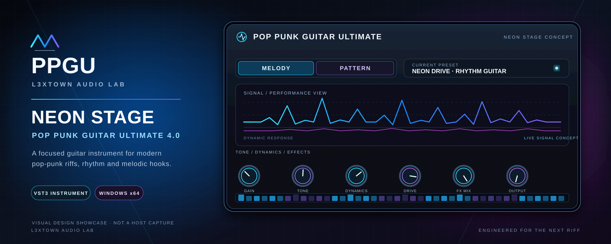

<div align="center">



# DOWNLOAD CENTER
### WINDOWS x64 · VST3 INSTRUMENT

**PLAY. CREATE. ROCK.**

</div>

---

## Current release candidate — run #827

**Last checked status: Windows Release build in progress.**

The source fix for the missing generated JUCE BinaryData.h has been committed. Sample-cache restore, license validation, x64 CMake configuration and pre-build validation passed. The Windows Release build step is active; CTest, VST3 discovery, pluginval strictness 5 and packaging remain pending.

[**OPEN CURRENT WINDOWS BUILD #827**](https://github.com/l3xtownbeats/POP-PUNK-GUITAR-ULTIMATE-4.0-VST-L3XTOWN-/actions/runs/43113647167)

- Source SHA: 0ef0ebe934350d57779328a5e0979f1134ae85f2
- Current complete ZIP: **not yet published**
- Do not install an older artifact as though it were the current release.

## Previous build — historical artifact

[Download previous VST3 + sample content package](https://api.github.com/repos/l3xtownbeats/POP-PUNK-GUITAR-ULTIMATE-4.0-VST-L3XTOWN-/actions/artifacts/13766348419/zip)

[Open its successful workflow run](https://github.com/l3xtownbeats/POP-PUNK-GUITAR-ULTIMATE-4.0-VST-L3XTOWN-/actions/runs/42821580125)

This artifact comes from an earlier source revision and package layout. It is for historical testing only and is not the canonical REV 13.0 release package.

## Required final package

The release archive name is fixed:

**POP_PUNK_GUITAR_ULTIMATE_Windows_x64_VST3_COMPLETE.zip**

Expected top-level layout:

```text
POP_PUNK_GUITAR_ULTIMATE/
├── VST3/
├── SOUNDBANK/
├── PRESETS/
├── Skins/             # only if real runtime assets are shipped
├── Resources/
├── Assets/
├── MANIFEST.json
└── INSTALL_AND_CONTENTS.txt
```

The live editor currently uses one fixed dark charcoal / magenta design. There is no accepted runtime skin selector or theme hot-swap. The package must not imply that a skin gallery exists. Do not manufacture placeholder skin packs merely to fill this directory.

## Release contents

- Windows x64 VST3 instrument.
- Redistributable guitar SoundBank with source licenses and checksums.
- Factory preset data and supported user-bank examples.
- Runtime resources and assets required by the actual editor.
- Installation instructions, manifest and package contents list.

The 300 factory catalogue records are definitions, not 300 verified playable presets. The release report must publish the tested playable count as N/300.

## Installation (after a verified package is published)

1. Extract the archive.
2. Copy the .vst3 bundle into C:\Program Files\Common Files\VST3\.
3. Keep the SoundBank in the package-prescribed location and do not rename its folders.
4. Rescan VST3 plugins in FL Studio 20.
5. Load the instrument, select a verified preset or licensed SFZ library, and audition it with MIDI.

Use INSTALL_AND_CONTENTS.txt shipped with the exact package. Do not apply instructions from a different artifact revision.

## References

- [Main product README](README.md)
- [Single engineering journal](Info.txt)
- [Preset catalogue](presets/)
- [Sample sourcing and license policy](docs/SAMPLE_LIBRARY_SOURCING_AND_LICENSE_POLICY.md)
- [SoundBank audit](docs/SB0_SOUNDBANK_CODE_AUDIT_RU.md)
- [Skin/UI implementation audit](SKIN/SKIN_ENGINE_GAP_AUDIT_RU.md)
