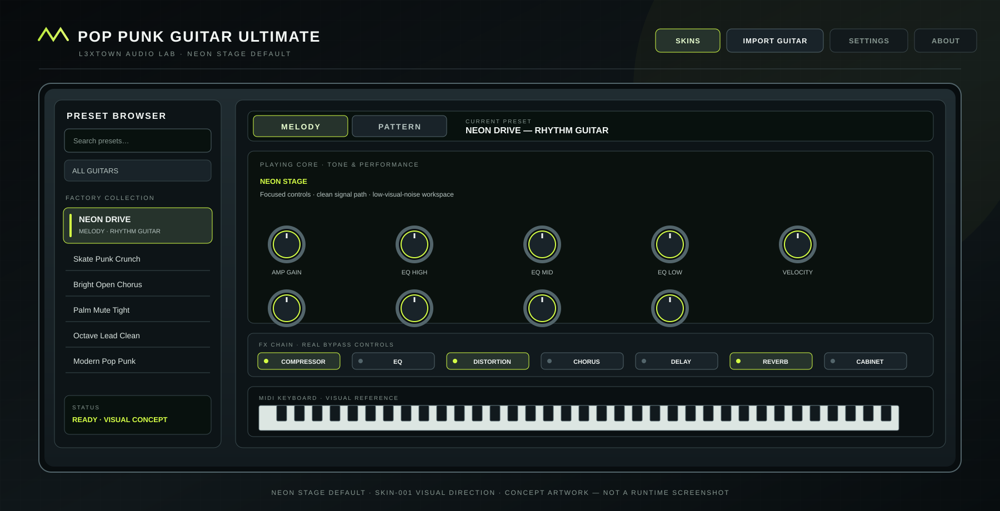

# POP PUNK GUITAR ULTIMATE 4.0
### L3XTOWN AUDIO LAB · NEON STAGE · WINDOWS x64 · VST3

**A focused pop-punk guitar instrument for riffs, power chords, palm-muted rhythms and melodic hooks.**

**PLAY. CREATE. ROCK.**

---

## Product overview

POP PUNK GUITAR ULTIMATE is a Windows x64 VST3 instrument project focused on fast, playable pop-punk guitar production. The product direction combines a sample-based guitar engine, MELODY and PATTERN workflows, a focused effect chain, preset definitions and a modular NEON STAGE interface.

## Core project areas

- **MELODY** — single-note riffs, octave lines, leads and melodic hooks.
- **PATTERN** — chord-driven rhythm parts, downstrokes, upstrokes and palm-muted patterns.
- **Sampler** — SFZ/WAV-oriented sample playback and mapping.
- **Effects** — the approved multi-stage FX architecture.
- **Themes** — modular visual skins and theme resources.
- **Presets** — factory preset definitions and mappings.

## Technical baseline

- Windows x64
- VST3 instrument with MIDI input
- JUCE 7.0.12
- C++20
- CMake 3.22+
- MSVC x64 toolchain

## Build and project records

- **Engineering source of truth:** [Info.txt](Info.txt)
- **Build configuration:** [CMakeLists.txt](CMakeLists.txt)
- **Project documentation:** [docs/](docs/)
- **Theme system:** [SKIN/](SKIN/)
- **Repository workflows:** [GitHub Actions](.github/workflows/)

## Visual identity

The repository cover uses the full NEON STAGE product artwork: a designed interface showcase, not a blank placeholder. The artwork is illustrative and must not be mistaken for a runtime capture or proof that every represented control is implemented. Runtime status remains governed by source code, inventories and test evidence.

## Development integrity

This branch is a development snapshot. Do not infer release readiness from the cover, preset counts, theme previews or design mockups. Preserve the approved control contract, FX bypass IDs, theme manifests, sample provenance and portable VST3 packaging requirements when changing the project.

---

**L3XTOWN AUDIO LAB · ENGINEERED FOR THE NEXT RIFF**

