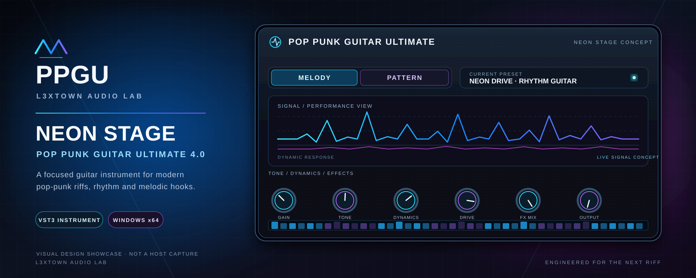
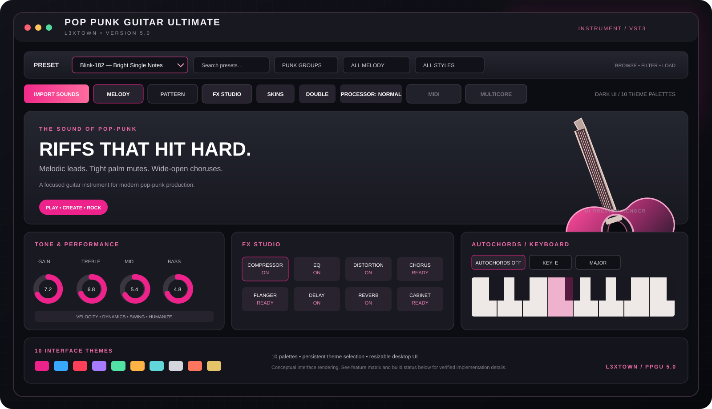

# POP PUNK GUITAR ULTIMATE 5.0
### L3XTOWN · WINDOWS VST3 GUITAR INSTRUMENT

**THE POP-PUNK GUITAR WORKSTATION — RIFFS, LEADS, POWER CHORDS & BIG CHORUSES.**

**PLAY · CREATE · ROCK**

---

## THE INSTRUMENT

*Interface preview rendering — a visual presentation of the 5.0 layout. The feature matrix below distinguishes implemented controls from functions still under development.*

---

## 5.0 AT A GLANCE

POP PUNK GUITAR ULTIMATE is an evolving sample-based guitar instrument focused on pop-punk, skate-punk, melodic punk and alternative-rock production. It is designed for fast MIDI composition: play guitar notes from a keyboard, build chord-driven rhythm parts, shape the tone, and move quickly from a verse riff to a wide chorus sound.

The 5.0 development branch consolidates the preset browser, sound-character and playing-style filters, performance modes, FX Studio, AutoChords controls, DOUBLE processing, selectable interface palettes and the SFZ/WAV sample engine into one product direction.

### Core workflow

| MELODY | PATTERN | SOUND |
|:---:|:---:|:---:|
| Play individual chromatic guitar notes from MIDI keys. | Choose a chord/rhythm preset and use incoming MIDI notes or chords as the musical input. | Select clean, acoustic, crunch, driven and muted sound directions where the loaded library provides the required articulations. |

**Important:** this is a development build, not a finished commercial release. The 300-entry preset catalogue is validated as data, but catalogue presence alone does not mean all presets are fully playable. Pattern performance recordings, complete sample-to-preset resolution, MIDI editor and multicore controls remain release gates. No claim of final FL Studio 20 acceptance, complete 300-preset playback or commercial release readiness is made here.

---

## DOWNLOADS

### Windows x64 VST3 + sound library + presets

### [⬇ DOWNLOAD COMPLETE WINDOWS x64 PACKAGE](https://api.github.com/repos/l3xtownbeats/POP-PUNK-GUITAR-ULTIMATE-4.0-VST-L3XTOWN-/actions/artifacts/13804429027/zip)

**VST3 plugin · redistributable guitar WAV libraries · SFZ maps · 300 preset definitions**

The latest successful package currently available is GitHub Actions artifact **13804429027**, produced by workflow run **42905436604** from commit `ad7216845e1e33236241937c1aed1a8e33a22a96`. It is a real downloadable package, approximately 1.66 GB, and is not the same source revision as the newer interface work described on this branch.

- [Download complete package — VST3 + Samples + Presets](https://api.github.com/repos/l3xtownbeats/POP-PUNK-GUITAR-ULTIMATE-4.0-VST-L3XTOWN-/actions/artifacts/13804429027/zip)
- [Download source-review archive](https://api.github.com/repos/l3xtownbeats/POP-PUNK-GUITAR-ULTIMATE-4.0-VST-L3XTOWN-/actions/artifacts/13804522885/zip)
- [Factory preset catalogue — JSON, 300 definitions](presets/factory_bank_300.json)
- [Factory preset catalogue — raw JSON download](https://raw.githubusercontent.com/l3xtownbeats/POP-PUNK-GUITAR-ULTIMATE-4.0-VST-L3XTOWN-/feature/ppgu-5-import-sounds/presets/factory_bank_300.json)
- [Portable MELODY preset example](presets/examples/Example-Melody.ppgm)
- [Portable PATTERN preset example](presets/examples/Example-Pattern.ppgp)

**Separate downloads and packaging status**

| Asset | Availability |
|---|---|
| VST3 plugin | Included in the complete Windows package above. |
| Guitar sample library | Included in the complete package under `Samples/`. A separate standalone library ZIP has not been published. |
| Factory presets | The 300-definition JSON catalogue is available separately. The complete package also contains the preset directory. |
| Interface skins | 10 theme palettes are built into the plugin UI code. A separate external skin-pack ZIP is not currently published. |
| Latest 5.0 interface build | Being rebuilt and validated by the current workflow. Do not use the older artifact above as proof that the latest interface commit has passed. |

GitHub Actions artifacts are temporary downloads and may require GitHub access. The current successful package expires **8 February 2027**. A permanent versioned GitHub Release will be created only after the release candidate is frozen and validated.

### Current build in progress

[**OPEN CURRENT 5.0 WINDOWS BUILD — RUN 42910485080**](https://github.com/l3xtownbeats/POP-PUNK-GUITAR-ULTIMATE-4.0-VST-L3XTOWN-/actions/runs/42910485080)

This run checks out commit `6ff1f2680740da2ab45aa91fa0ec0e6a9930925d`. At the time this page was updated, CMake configuration had passed and the Windows VST3 build was running. The final CTest, pluginval strictness-level 5 and package steps had not yet completed. The page must not be read as a successful result for that in-progress run.

---

## INTERFACE & WORKFLOW

### Unified preset browser

The top browser is designed around a single selected base preset, with filters for preset family, sound character and playing style. Preset selection is independent from the MELODY/PATTERN performance switch: the same musical identity can be approached through the selected performance mode where the preset data supports it.

- **Preset search** — find a preset by name or style.
- **Preset family** — browse the punk-group catalogue.
- **Sound character** — filter by the tonal direction.
- **Playing style** — filter by articulation / performance direction.
- **Off / no overlay** — intended neutral selection when no additional style is wanted.
- **MELODY / PATTERN** — choose how the selected preset is performed.

The catalogue includes 150 MELODY and 150 PATTERN definitions. These definitions are validated as a catalogue; complete runtime integration of every entry is still in progress.

### MELODY

A direct note-playing workflow. Each MIDI key is intended to trigger the corresponding chromatic guitar pitch, without automatic rhythm playback. Sound character and playing style are separate ideas: for example, a clean lead, a muted lead, a crunch riff or an acoustic arpeggio should be selectable without changing the identity of the base preset.

### PATTERN

A chord-driven performance workflow. The musical input supplies the chord or root-note changes, while the selected pattern supplies the rhythmic and articulation concept. The intended style vocabulary includes straight eighths, downstrokes, alternate picking, palm-muted verses, open choruses, stop-start grooves and arpeggios.

**Runtime limitation:** the pattern scheduler and pattern definitions are present, but full real-sampler pattern playback with a complete recorded strum/chord performance library has not yet passed release acceptance.

### AutoChords

The 5.0 UI and parameter work adds an AutoChords control with key and scale selection. It is intended for PATTERN use: a single incoming MIDI note can be expanded into a diatonic triad in the selected key/scale. It can be switched OFF so incoming MIDI notes/chords are not automatically expanded. In MELODY mode, AutoChords is not intended to alter single-note playing.

The latest AutoChords implementation is part of the current branch build and remains subject to the active CI and runtime regression checks.

### FX Studio

A separate FX Studio window provides controls for the available effect modules and their parameters:

- Compressor
- EQ
- Amp / Distortion
- Chorus
- Flanger
- Delay
- Reverb
- Cabinet
- Double Track
- Output

The UI exposes a broader set of parameters than the currently accepted DSP path. Each control still requires parameter-to-DSP verification, signal-flow checks, preset recall checks and listening tests before the complete rack can be called release-ready.

### DOUBLE

The DOUBLE function adds a stereo thickening layer around the dry guitar signal. The current DSP implementation uses short offset/modulated delay layers. It is a widening/thickening approximation, not two separately performed guitar takes. Mono compatibility and phase behaviour remain part of acceptance testing.

### PROCESSOR

The current PROCESSOR selector offers GOOD, NORMAL, NIGHT and ECO. The present implementation limits the maximum voice count by quality setting (64 / 32 / 16 / 8). It is not yet a complete global CPU-quality engine with all interpolation, oversampling and DSP quality stages independently profiled.

### SKINS

The UI contains ten selectable built-in colour palettes:

1. Neon Pink
2. Midnight Blue
3. Blood Red
4. Violet
5. Cyber Green
6. Amber
7. Arctic
8. Graphite
9. Sunset
10. Gold Edition

The selected palette is saved in plugin state. The palettes recolour the main editor and FX Studio. They are currently built-in palettes, not ten separate external skin archives.

### MIDI and MULTICORE

The MIDI Piano Roll and MULTICORE controls are visible in the interface plan, but remain disabled until their complete editor / worker-thread implementations are connected and tested. They are not advertised as operational features in this build.

---

## FACTORY PRESET CATALOGUE

### 300 authored preset definitions

| Preset family | Count | Intended use |
|---|---:|---|
| MELODY | 150 | Single-note guitar tones, riffs, lead lines and hooks. |
| PATTERN | 150 | Chord-driven rhythm and performance styles. |
| **TOTAL** | **300** | Structured factory catalogue. |

### 21 artist-inspired style profiles

The catalogue uses these names as stylistic reference points for original sound and performance concepts. It does not contain redistributed master recordings, stems or proprietary commercial-library samples.

1. Blink-182
2. Sum 41
3. Simple Plan
4. New Found Glory
5. Good Charlotte
6. Mest
7. Angels & Airwaves
8. The All-American Rejects
9. MGK
10. Avril Lavigne
11. The Offspring
12. Green Day
13. Bowling for Soup
14. Sugarcult
15. All Time Low
16. Fall Out Boy
17. Yellowcard
18. My Chemical Romance
19. Less Than Jake
20. Fenix TX
21. Midtown

### Sound-character palette

Clean · Crunch · Drive · Palm Mute · Open Chords · Acoustic · Lead Drive · Muted Chugs.

### Playing-style vocabulary

Lead Guitar · Solo Guitar · Tight Riffs · Palm-Mute Verse · Open-Chord Chorus · Power Chords · Straight Eighths · Fast Downstrokes · Alternate Picking · Ska Upstrokes · Syncopated Stops · Octave Hooks · Arpeggio · Acoustic Strumming · Dynamic Build.

**Preset data limitation:** the factory JSON is a structured catalogue. Some definitions explicitly identify their sample requirements and integration status. The presence of an entry does not prove that its intended samples, velocity layers, round robins, articulations, pattern performance or FX snapshot are all connected in the plugin. See the per-preset `status` and `sampleRequirement` fields in the JSON.

---

## SOUND BANK & SAMPLE SOURCES

The sampler is designed around SFZ mappings and WAV sample playback. The complete downloadable package includes redistributable source libraries and retains their licence files and mapping metadata.

### Included source families

- **Meta Open Sound — Meta Steel Guitar**
- **Meta Open Sound — Meta Nylon Guitar**
- **FreePats FSBS — Clean Electric Guitar**
- **FreePats FSBS — Distortion 1**
- **FreePats FSBS — Distortion 2**

The included source sets are distributed under CC0 1.0 according to their retained source licence files. See:

- [Sample sourcing and licence policy](docs/SAMPLE_LIBRARY_SOURCING_AND_LICENSE_POLICY.md)
- [Meta Open Sound clearance notes](licenses/META_OPEN_SOUND_CLEARANCE.md)
- [Meta Open Sound source project](https://github.com/facebookincubator/Meta-open-sound)
- [FreePats clean guitar source](https://github.com/freepats/electric-guitar-FSBS-clean)
- [FreePats distortion 1 source](https://github.com/freepats/electric-guitar-FSBS-dist1)
- [FreePats distortion 2 source](https://github.com/freepats/electric-guitar-FSBS-dist2)

Commercial Session Guitarist libraries, paid sample packs, protected recordings and artist master tracks are not included.

### SFZ / WAV engine

| Area | Current implementation / status |
|---|---|
| SFZ parsing | Parser with global / master / group / region inheritance. |
| WAV region lookup | Key, velocity and MIDI-channel selection. |
| Region metadata | Root key, tuning, volume, pan, release and loop metadata. |
| Voice engine | Bounded polyphony, maximum 64 voices before PROCESSOR quality cap. |
| Loop modes | Continuous, sustain, ping-pong and one-shot metadata support. |
| Loading | SFZ loading on a worker thread; file scanning and loading are kept off the audio callback. |
| Streaming | Background WAV page streaming and bounded page-cache design are integrated into the sampler path; stress and long-duration acceptance remain. |
| General import | A complete multi-format Sounds Bank manager, transactional import UI, previews and all-format decoder pipeline are not yet complete. |

Large sound libraries are intended to remain disk-backed and stream through bounded caches. Cache configuration figures in the engineering notes are not a promise of total plugin RAM usage; full-library profiling is still required.

---

## TECHNICAL SPECIFICATION

| Specification | Target / current project configuration |
|---|---|
| Product | POP PUNK GUITAR ULTIMATE 5.0 |
| Developer label | L3XTOWN |
| Platform | Windows 10 / Windows x64 |
| Plugin format | VST3 instrument |
| Framework | JUCE 7.0.12 |
| Language | C++20 |
| Build system | CMake |
| Compiler | Visual Studio 2022 / MSVC v143 |
| Intended DAW | FL Studio 20 |
| Audio output | Stereo |
| Input | MIDI notes, velocity and channel |
| Sampler source | SFZ mappings + WAV samples |
| Factory catalogue | 300 definitions (150 MELODY / 150 PATTERN) |
| UI | Resizable dark interface, 10 built-in colour palettes |
| Effects | Compressor, EQ, distortion/amp, chorus, flanger, delay, reverb, cabinet and DOUBLE controls |

---

## BUILD & VALIDATION PIPELINE

The 5.0 branch is built with GitHub Actions on Windows Server 2022. The intended pipeline is:

1. Checkout the selected source branch and commit.
2. Validate the 300-preset factory catalogue.
3. Validate portable preset examples.
4. Validate APVTS parameter IDs and state persistence.
5. Verify the redistributable sample cache and retained licence files.
6. Configure the x64 Release build with CMake / Visual Studio 2022.
7. Compile the VST3 and test executables.
8. Run CTest regression tests.
9. Locate the generated VST3 bundle.
10. Run pluginval at strictness level 5.
11. Package the VST3, Samples, presets and installation notes.
12. Upload the build artifact.

### Current 5.0 branch

- Branch: [`feature/ppgu-5-import-sounds`](https://github.com/l3xtownbeats/POP-PUNK-GUITAR-ULTIMATE-4.0-VST-L3XTOWN-/tree/feature/ppgu-5-import-sounds)
- Current implementation commit at the start of the latest build: [`6ff1f268`](https://github.com/l3xtownbeats/POP-PUNK-GUITAR-ULTIMATE-4.0-VST-L3XTOWN-/commit/6ff1f2680740da2ab45aa91fa0ec0e6a9930925d)
- [Full commit history for the 5.0 branch](https://github.com/l3xtownbeats/POP-PUNK-GUITAR-ULTIMATE-4.0-VST-L3XTOWN-/commits/feature/ppgu-5-import-sounds/)
- [Current Windows VST3 workflow](https://github.com/l3xtownbeats/POP-PUNK-GUITAR-ULTIMATE-4.0-VST-L3XTOWN-/actions/workflows/vst3-build.yml)
- [Current build run 42910485080](https://github.com/l3xtownbeats/POP-PUNK-GUITAR-ULTIMATE-4.0-VST-L3XTOWN-/actions/runs/42910485080)
- [Last successful package run 42905436604](https://github.com/l3xtownbeats/POP-PUNK-GUITAR-ULTIMATE-4.0-VST-L3XTOWN-/actions/runs/42905436604)

A successful CMake build is not the same as a successful CTest run; pluginval is not the same as opening and playing the plugin in FL Studio 20. Final release acceptance also requires manual host tests, preset recall, MIDI input, no stuck notes, no clicks, sample-path verification, CPU/RAM profiling and long-playback testing.

### Release gates

| Milestone | Status |
|---|---|
| M1 — VST3 foundation / parameter registry | Windows x64 build and parameter audit have passed on earlier revisions; current branch must pass again. Manual state, automation and panic acceptance remains. |
| M2 — SFZ/WAV sampler | Streaming implementation and regression coverage exist; long-playback, cache stress, voice-stealing, click-free and full-library acceptance remain. |
| M3 — Pattern scheduler / real performance playback | Scheduler exists; complete sampler-linked pattern performance and recorded chord/strum library acceptance remain. |
| M4 — AutoChords / chord voicing | UI and implementation work added on the current branch; current CI and musical regression checks remain. |
| M5 — Preset integration | 300 definitions are validated as data; complete sample / FX / articulation / pattern resolution remains. |
| M6 — UI / skins | Main interface and 10 built-in palettes are present in the development branch; full interaction and host resizing checks remain. |
| M7 — MIDI editor / multicore / full Sounds Bank | Not release-ready; corresponding controls remain disabled or partial. |
| Final — FL Studio 20 acceptance | Must be completed on a real Windows host before a final release claim. |

---

## INSTALLATION

For the currently available package:

1. Download the complete Windows x64 ZIP from the Downloads section.
2. Extract the archive.
3. Copy the `.vst3` bundle into:

   `C:\Program Files\Common Files\VST3\`

4. Keep the extracted `Samples/` folder available beside the package. Do not delete the sample directory.
5. Open FL Studio 20 (or another VST3 host) and rescan plugins.
6. Load POP PUNK GUITAR ULTIMATE and verify the sample-library path if the plugin requests it.

The package includes `INSTALL_AND_CONTENTS.txt` with the same basic instructions. The older downloadable artifact may not contain the newest 5.0 UI changes; use the current workflow link to track the updated build.

---

## PROJECT DOCUMENTATION

- [Master product specification](docs/MASTER_PRODUCT_SPEC_4_0_RU.md)
- [Unified 5.0 preset browser and Sounds Bank architecture](docs/PPGU_5_UNIFIED_PRESET_BROWSER_AND_SOUNDS_BANK_RU.md)
- [5.0 preset browser sound/style architecture](docs/PRESET_BROWSER_5_0_SOUND_STYLE_ARCHITECTURE_RU.md)
- [Sounds Bank library system](docs/BANK_LIBRARY_SYSTEM_RU.md)
- [Import Sounds implementation plan](docs/IMPORT_SOUNDS_5_0_IMPLEMENTATION_RU.md)
- [MIDI Piano Roll specification](docs/MIDI_PIANO_ROLL_5_0_SPEC_RU.md)
- [Sample streaming and page-cache design](docs/SAMPLE_STREAMING_PAGE_CACHE_DESIGN_RU.md)
- [Sample sourcing and licence policy](docs/SAMPLE_LIBRARY_SOURCING_AND_LICENSE_POLICY.md)
- [Final integration checklist](docs/FINAL_INTEGRATION_CHECKLIST.md)
- [M1 / M2 / M3 blocker audit](docs/M1_M2_M3_BLOCKER_AUDIT_RU.md)
- [Development journal](docs/ЖУРНАЛ_РАЗРАБОТКИ_RU.md)
- [Bug log](docs/ЖУРНАЛ_БАГОВ_RU.md)
- [Source repository](https://github.com/l3xtownbeats/POP-PUNK-GUITAR-ULTIMATE-4.0-VST-L3XTOWN-)

---

## BRAND & CONTACT

**L3XTOWN — MUSIC · SOUND · DEVELOPMENT**

**Business & project enquiries:** l3xtown@yandex.ru

---

### POP PUNK GUITAR ULTIMATE 5.0 BY L3XTOWN

*Built for riffs, hooks, power chords and loud choruses.*

**PLAY. CREATE. ROCK.**

